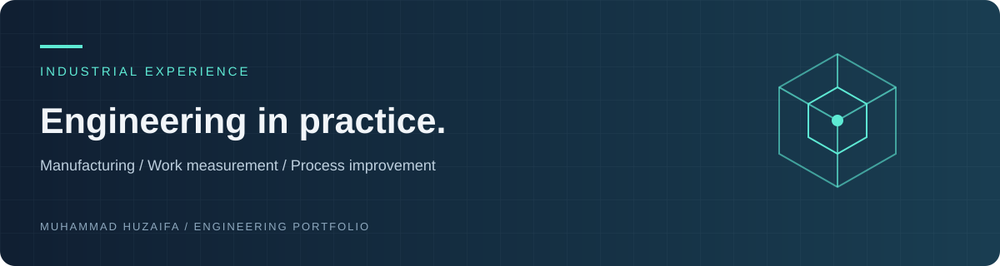

# Professional Work Experience

Practical experience connecting industrial engineering methods with manufacturing operations, process documentation, and client support.

## Manufacturing and operations

### Vision Technologies — Management Trainee Officer

Worked in football manufacturing, with exposure to time studies, value-stream mapping, facility layouts, 3D CAD, and production-process review.

**Focus:** work measurement · workflow improvement · manufacturing documentation  
[View experience certificate](https://github.com/huzaifaalvi19-source/Professional-Work-Experience/blob/main/Vision%20Technologies%20(Experience%20Certificate).pdf)

### Kohinoor Textile Mills — Industrial Engineering Intern

Studied made-ups operations and stitching workflows, including Standard Allowed Minute (SAM) studies, production documentation, and the transition toward digital records.

**Focus:** textile operations · time studies · process flow · documentation  
[Explore internship overview](https://github.com/huzaifaalvi19-source/Professional-Work-Experience/tree/main/Kohinoor%20Textile%20Mills) · [Read report](https://github.com/huzaifaalvi19-source/Professional-Work-Experience/blob/main/Kohinoor%20Textile%20Mills/Report%201...pdf) · [View certificate](https://github.com/huzaifaalvi19-source/Professional-Work-Experience/blob/main/Kohinoor%20Textile%20Mills/Cert%20KTML%20(1).jpeg)

### Pakistan Aeronautical Complex — Intern

Gained exposure to aircraft rebuild operations, inspection, quality practices, technical documentation, and maintenance workflows.

**Focus:** operational observation · quality · documentation  
[View internship certificate](https://github.com/huzaifaalvi19-source/Professional-Work-Experience/blob/main/PAC%20Kamra%20Internship%20Cert%20(1).jpeg)

## Communication and client support

### Skyscrapers — International Support Executive

Supported client communication, concurrent requests, record updates, and issue follow-up.

**Focus:** communication · coordination · service support  
[View experience document](https://github.com/huzaifaalvi19-source/Professional-Work-Experience/blob/main/Skyscrapers%20-%20International%20Support%20Executive%20%20(1).pdf)

## What this experience contributes

An understanding of how people, processes, equipment, and information interact in day-to-day operations—and how measurement and clear documentation can support improvement.

---

[Portfolio](https://huzaifaalvi19-source.github.io/Personal-Portfolio/) · [Research](https://github.com/huzaifaalvi19-source/Research-Publications) · [Projects](https://github.com/huzaifaalvi19-source/Selected-Bsc-Industrial-Engineering-Semester-Projects) · [LinkedIn](https://www.linkedin.com/in/muhammad-huzaifa-c1a2t3) · [ORCID](https://orcid.org/0009-0008-8113-1315)
